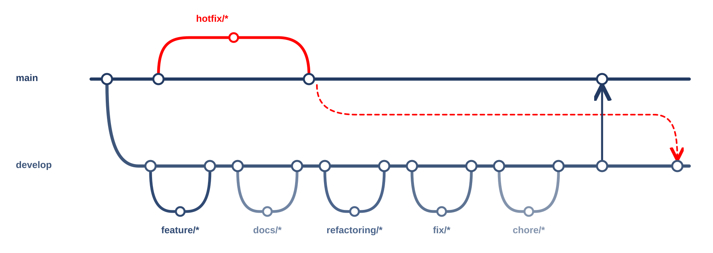

# 캠퍼스 트래커

서경대학교 캠퍼스의 실제 이동 데이터와 3D 지도를 만드는 수집·모델링 도구입니다.

## 개발 목적

- 휴대폰(iPhone·Android)이 보내는 위치·움직임·기압·걸음 데이터를 원본 그대로 모으고, 이를 융합(Fusion)해 실내외·층간 이동 궤적을 만듭니다.
- 수집한 궤적과 현장 자료로 캠퍼스 길 도로망(길·계단·승강기·장소)과 건물·지형 3D 지도를 만들고 편집합니다.
- 이렇게 만든 지도는 사용자용 길찾기 서비스(캠퍼스 백엔드·앱)가 배포하는 지도 자료의 원천이 됩니다.

## 사용 도구

| 구분 | 도구 |
|---|---|
| 서버 | Node.js, TypeScript, Express 5, Socket.IO 4, pg(ORM 없음), Zod, JWT |
| 화면 | Vite, TypeScript, CesiumJS(3D 지도), Socket.IO 클라이언트 |
| 데이터베이스 | PostgreSQL 16, PostGIS 3.5 (Docker Compose) |
| 수집 앱 | iOS(Swift), Android(Kotlin·Compose) |
| 협업 | Git·GitHub, GitHub Actions |

## 브랜치 전략



그림에서 작업 브랜치는 `develop`에서 분기해 돌아옵니다. 위로 향하는 화살표는 배포 PR(`develop` → `main`), 빨간 점선은 hotfix 수정의 `develop` 반영을 뜻합니다.

- `main`: 배포용 브랜치. 일반 변경은 PR로 병합하고, 긴급 hotfix는 PR 없이 직접 병합·push합니다.
- `develop`: 개발 통합용 브랜치. 작업 브랜치는 최신 `develop`에서 분기하고 PR로 돌아옵니다.
- `feature/*`: 기능 추가, `docs/*`: 문서, `refactoring/*`: 리팩터링, `fix/*`: 일반 오류 수정, `chore/*`: 의존성·CI 등 설정 변경.
- 배포 준비가 완료되면 `develop` → `main` PR을 생성합니다.
- `hotfix/*`: 최신 `main`에서 분기하여 필요한 검증 후 PR 없이 `main`으로 직접 병합·push하고 긴급 배포합니다. 같은 수정 사항을 `develop`에도 직접 병합하거나 cherry-pick으로 반영합니다.
- 작업 브랜치는 병합 후 삭제합니다. `release/*`는 별도 배포 후보 검증이 필요해질 때 도입합니다.

PR은 목적·변경·확인·배포/후속을 각각 한 줄로 적습니다. 미검증은 이유를, 영향이나 후속 작업이 없으면 `없음`을 적습니다. [PR 템플릿](.github/pull_request_template.md)을 사용합니다. CI 필수 검사·브랜치 보호·CD는 별도 설정이 필요합니다.

## PR 작성 양식

각 항목에 한 줄씩 답합니다. hotfix는 PR 없이 진행하므로 이 양식의 대상에서 제외합니다. hotfix 커밋이나 작업 기록에는 검증 결과와 `develop` 반영 여부를 남깁니다. 새 PR 본문에 자동으로 표시하려면 템플릿을 GitHub 기본 브랜치에 병합해야 합니다.

```markdown
## 목적
왜 필요한가?

## 변경
무엇이 달라졌나?

## 확인
확인 방법과 결과. 못 했다면 "미검증: 이유"

## 배포·후속
DB/환경 변수/API 영향과 남은 작업. 없으면 "없음"
```

실행 방법·환경 변수·구조 등 개발 세부 내용은 [개발 가이드](docs/개발-가이드.md)에 있습니다. 휴대폰 ↔ 서버 계약은 [API 계약](docs/API_CONTRACT.md)에 있습니다.
